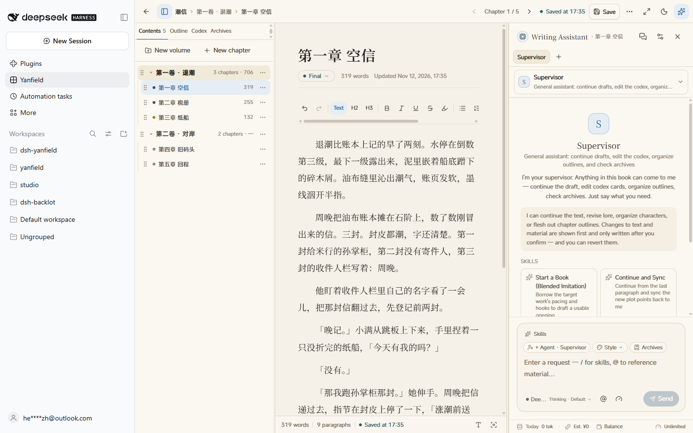
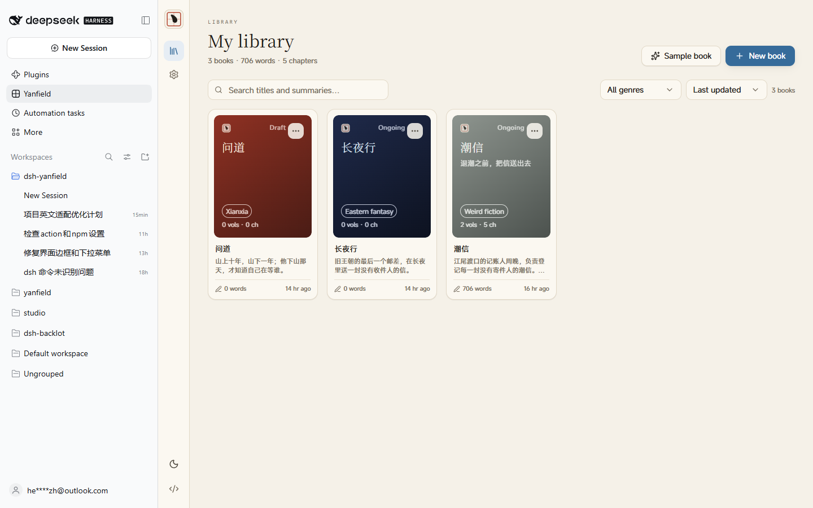

<div align="center">


# Yanfield 砚田

**A long-form writing desk inside DeepSeek Harness.**

Manuscript, outline, world notes and an AI assistant on one desk.<br>
Your book stays local, the model is the DeepSeek you already configured, and every AI edit is reviewed by you.

[](#install)
[](https://nodejs.org)
[](https://github.com/ZzimaR/dsh-yanfield/releases/latest)
[](LICENSE)

[Install](#install) · [First run](#first-run) · [Features](#features) · [AI and cost](#ai-and-cost) · [Screenshots](#screenshots) · [Data and backup](#data-and-backup) · [Troubleshooting](#troubleshooting) · [Development](#development) · [中文](README.md)

</div>

> [!NOTE]
> Yanfield is still being polished; UI and behavior will keep changing. Bugs and ideas are welcome in [Issues](https://github.com/ZzimaR/dsh-yanfield/issues/new/choose) — the Bug report / Feature request forms (with environment and steps) get fixed faster. Pull requests are welcome too.

[](docs/screenshots/en-editor.png)

The three-pane writing desk in DeepSeek Harness — chapter tree, prose, and the AI assistant side by side. All UI labels in these screenshots are English; the manuscripts shown are the bundled Chinese demo books (create a new book to write in English).

<p align="center"><sub>Three-column writing desk · sample manuscript · click for full size</sub></p>

## What this plugin is

Yanfield is a **DeepSeek Harness plugin**, not a standalone app. After installation a **Yanfield** entry (「砚田」 when the interface is Chinese) appears in the Harness sidebar; opening it gives you a long-form writing desk rendered inside the panel.

- **Writing desk** — novels / volumes / chapters, three columns (outline · prose · AI), autosave, word counts, focus mode, adjustable typography, and two themes (rice-paper light, night-sail dark).
- **Notes at hand** — chapter blueprints, characters, world settings, foreshadowing and story archives live in the left rail, edited in place without leaving the page.
- **AI proposes, you decide** — the assistant reads your notes, works in several steps, and proposes prose and note changes; prose is reviewed paragraph by paragraph (green insertions, red deletions) and only what you keep is written into the manuscript.
- **Local first** — manuscript, notes and conversations live in a local SQLite file; the model comes from the DeepSeek service you already configured in Harness, so there is no second API key to manage. The bundled sample books are Chinese demo manuscripts, included to show the workflow; create a new book to write in English.
- **English and Chinese** — the interface follows the Harness language (`Settings → General → Language`): the sidebar entry and every screen switch between 砚田 and Yanfield. Manuscripts are never translated, and the AI replies in the language you write in.

## Install

Requires DeepSeek Harness `>=0.2.1-rc.5`. Choose the command for your profile to install the prebuilt package from [npm](https://www.npmjs.com/package/dsh-yanfield).

```bash
# Web
dsh plugin --profile web add dsh-yanfield

# Desktop
dsh plugin --profile desktop add dsh-yanfield
```

Then **quit Harness completely and start it again** — a page refresh is not enough, because the plugin ships host-side code.

For offline installation, download `dsh-yanfield.tgz` from [GitHub Releases](https://github.com/ZzimaR/dsh-yanfield/releases/latest) and run `dsh plugin --profile <profile> add "<local archive path>"`.

How to confirm it worked:

1. a **Yanfield** entry appears in the left sidebar;
2. Check the version and build time in `Yanfield → Settings → About`. The build time comes from the bundle.

To update, run `dsh plugin --profile <profile> add dsh-yanfield@latest` in the same profile and restart Harness. To roll back, replace `@latest` with the desired version, such as `@0.1.1`. This also switches an existing GitHub install to npm.

## First run

1. Open **Yanfield** from the sidebar and click **New book** on the shelf (title, genre, cover color, one-line pitch).
2. Open the novel and click **Write** to enter the three-column desk.
3. Type into the AI box on the right, e.g. "make the first paragraph more vivid, only the first paragraph", "draft a blueprint for the next chapter", "create a character card for Zhou Wan".
4. Prose edits open in a review view: keep or revert each paragraph, then press **Confirm review** — only kept paragraphs are written. Note changes are confirmed item by item in the task card.

Where the model comes from (`Settings → Model services`):

| Route | What you need | Notes |
| --- | --- | --- |
| DSH account sign-in | Signed in to DeepSeek inside Harness | Recommended, zero setup, balance readable |
| Official API key | `DEEPSEEK_API_KEY` | Pay per token; can also be stored on Harness' model page |
| Offline demo | Nothing | Template text only, for trying the UI; cannot really edit |

Both real routes can be switched in Settings; an unavailable route explains why (not signed in / no key).

## Features



**Writing**

- Novel / volume / chapter tree with word counts and status; create, reorder, navigate
- Autosave with adjustable delay plus manual save; live word, paragraph and reading-time stats
- Typography controls: serif or sans, size, weight, line height, letter spacing, paragraph spacing, margins, max line width
- Focus mode, typewriter mode, writing goal and daily target
- `Alt + 1` collapse the outline, `Alt + J` focus the AI box, `Ctrl / ⌘ + K` quick jump, `Ctrl / ⌘ + F` find in chapter

**Notes**

- Three-level outline: book / volume / chapter blueprints (goal, conflict, scene beats, hooks)
- Character cards, world settings, foreshadowing, story archive (chapter summary, character states, setting changes, timeline, unresolved conflicts)
- Settings stay hidden from the AI until their reveal chapter; turning off "AI visibility" hides them even from explicit `@` references
- TXT import (chapter titles detected, preview before writing), Markdown / TXT export

**AI assistant**

- One conversation handles continuation, rewriting, card creation, note edits and blueprint drafting, with skill presets, style presets and a customizable persona
- `@` to reference chapters, characters, settings, foreshadowing and archives; context budget and per-section preview
- Progress steps keep their order, the current step updates in place, and autoscroll pauses while you read back
- Prose changes are reviewed inline (green insertions, red deletions); note changes are compared field by field
- The current request determines which changes the assistant can propose. Card creation produces card proposals only. Request both prose and note updates to extract evidence-backed notes from the new draft
- Save frequently used instructions as prompt presets. The toolbar's continuation, expansion, polishing, and AI-tone cleanup shortcuts use the corresponding presets


## AI and cost

- **Models** — by default the DeepSeek account already signed in to Harness; you can switch to an official API key. Both routes live in `Settings → Model services` with availability and reasons.
- **Catalog** — `deepseek-flash` (DeepSeek-V4.1-Flash, text and images) and `deepseek-v4-pro` (DeepSeek-V4-Pro, text only), roughly 1M tokens of context each; new models registered in Harness are synced automatically.
- **Balance** — the **Balance** button under the composer queries the signed-in DSH account, no key needed.
- **Cost** — the footer shows *today's* cumulative estimate, not a single task. Unit prices come from a built-in DeepSeek price table and switch between peak and off-peak by Beijing time (peak: weekdays 09:00–12:00 and 14:00–18:00; everything else, including weekends and public holidays, is off-peak at half price). **Estimates only — the DeepSeek bill is authoritative.**
- **Usage controls** — a short model call determines the scope of each request. Routine decisions skip deep thinking, short polishes use a lower thinking level, and long tool results are paginated.

## Screenshots

| Bookshelf (English UI) | Writing desk (English UI) |
| --- | --- |
| [](docs/screenshots/en-library.png) | [](docs/screenshots/en-editor.png) |

More: [model services](docs/screenshots/en-settings.png) · [Chinese screenshots](docs/screenshots/library.png) · [screenshot notes](docs/screenshots/README.md)

## Data and backup

- Manuscripts live in `$DSH_HOME/yanfield/yanfield.db` (plus `-wal` / `-shm`). `Settings → Data` shows the real path and can open the folder.
- Set `YANFIELD_DB_PATH` to select a database file. If the profile's `cordis.patch.yml` sets the plugin's `dataDir`, its `yanfield.db` takes precedence.
- Backup: quit Harness first, then copy the whole directory (copying SQLite while it runs can give an inconsistent snapshot).
- Before upgrading the database schema, Yanfield creates a full snapshot in the same folder. If the backup fails, the upgrade stops. After a successful upgrade, Yanfield keeps the three most recent automatic upgrade backups.
- Removing the plugin does not delete your manuscript; the database stays where it is.

## Troubleshooting

<details>
<summary>No **Yanfield** entry in the sidebar</summary>

Make sure you fully quit and restarted Harness (a page refresh is not enough), then check `Settings → Plugins` that `dsh-yanfield` is enabled and at the version you just installed.
</details>

<details>
<summary>"no API key" / model unavailable</summary>

The active route is the official API key route but no key is stored. Switch the route back to "DeepSeek account" in `Yanfield → Settings → Model services`, or store `DEEPSEEK_API_KEY` on Harness' model page.
</details>

<details>
<summary>Balance shows a dash or says not signed in</summary>

Balance comes from the DeepSeek account signed in to Harness. Sign in there first, then press **Balance** again.
</details>

<details>
<summary>Cost always says unknown</summary>

That request returned no usage (for example it was interrupted), or the model is not in the built-in price table and no unit price is configured in `Settings → AI & context`. Fill in the three prices to get an estimate.
</details>

<details>
<summary>Where is my manuscript / how do I move it</summary>

See "Data and backup" above. Copy the whole database directory to the new machine; if the path stays the same, nothing else is needed.
</details>

<details>
<summary>Uninstall</summary>

```bash
dsh plugin --profile desktop remove dsh-yanfield
```

Then restart Harness. Your manuscript is not deleted.
</details>

## Development

Requires Node.js ≥ 22.19 (build and checks only; the runtime comes from Harness).

```bash
npm ci      # install build dependencies from package-lock.json
npm test    # build dist/, check the manifest and run smoke tests
```

```bash
client/     plugin half: Shadow DOM mount, slot registration, style entry
src/host.ts host half: REST/SSE routes under /yanfield, model and account bridge
src/yanfield/  the desk itself (React components, domain logic, SQLite access)
scripts/    build, check, smoke, reinstall
docs/       features, AI and cost, architecture, development, FAQ
```

See [development](docs/en/development.md) for the build chain and local testing, [architecture](docs/en/architecture.md) for the data model, [features](docs/en/features.md) for the full list, [AI and cost](docs/en/ai-and-cost.md) for model details, and [FAQ](docs/en/faq.md) for troubleshooting.

中文文档：[README.md](README.md) · [docs/](docs/features.md)

## Roadmap

- **v0.1.x (current)**: writing desk, notes system, AI review and cost visibility;
- **Next**: chapter snapshots and rollback, EPUB export, richer writing stats;
- **Later**: knowledge-graph view, model comparison, collaborative review.

## Credits

The interface and domain logic come from [Yanfield](https://github.com/ZzimaR/Yanfield). This repository is its DeepSeek Harness plugin edition: models come from Harness, the theme follows the Harness light/dark setting, and multi-provider support is replaced by the two DeepSeek routes (DSH account / official API key).

## License

[PolyForm Noncommercial 1.0.0](LICENSE): use, study, modify and share freely; no commercial use. Novels written with it belong to their author.
