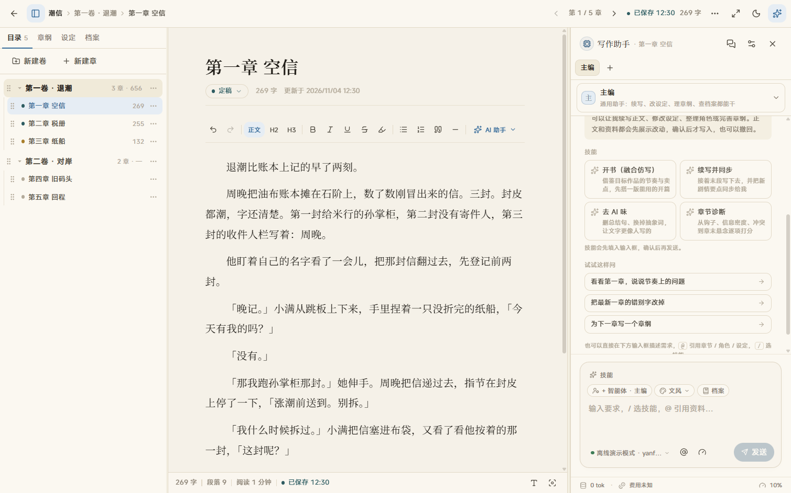

# 砚田 · DeepSeek Harness 插件

English: Yanfield is a long-form novel desk for DeepSeek Harness. The writing surface matches the standalone app. Manuscripts stay in a local SQLite file, and model calls go through the Harness model you already configured.

侧栏点「砚田」，进去就是原来的三栏写作台：书架、正文、章纲、设定、档案，以及先审阅再落库的 AI 改稿。宣纸 / 夜航两套主题都在。外层导航交给 Harness，书桌本身不改。



## 安装

需要 DeepSeek Harness `>=0.2.1-rc.5 <0.3.0`，Node.js `>=22.19`。带界面的插件装在 **web** profile。桌面版使用 `desktop` profile。

```bash
dsh plugin --profile web add github:ZzimaR/dsh-yanfield
```

```bash
dsh plugin --profile desktop add github:ZzimaR/dsh-yanfield
```

重启 Harness。左侧面板列表里会出现「砚田」，会话标题栏也有一个入口。

仓库已带构建产物，安装不会执行 `prepare` 或 `install` 脚本。

## 数据与模型

| | |
| --- | --- |
| 书稿 | `$DSH_HOME/yanfield/yanfield.db`。Windows 上如果独立砚田的库还没有未合并的 WAL，第一次会复制一份进来，之后两边分开写 |
| 默认模型 | profile 里名为 DeepSeek Harness 的服务，模型 ID 默认 `deepseek-flash`。可在插件配置里改 `provider` 和 `model` |
| 官方 Key | 仍可另加 DeepSeek 官方服务，用来查余额和按官方单价估算。Harness 模型不需要第二把 Key |
| 改稿 | 模型只产生候选。正文和资料都要你确认后才写入 |

插件配置写在 profile 的 patch 里，覆盖这一行时要带上原有字段：

```yaml
- id: yanfield
  name: dsh-yanfield
  config:
    provider: deepseek
    model: deepseek-flash
    # dataDir: D:/manuscripts/yanfield
```

`dataDir` 指向一个目录，库文件名固定是 `yanfield.db`。

## 权限

插件跑在 Harness 进程里，能读写上面的数据库，并调用当前 profile 的模型。它不另开网站，也不上传书稿。调用模型时，这次任务用到的上下文会交给 Harness 所配置的模型服务。

许可证是 [PolyForm Noncommercial 1.0.0](LICENSE)。可以自己用、改、分享，不能把这个软件用于商业目的。用它写出来的小说，版权归作者。

## 项目结构

```text
package.json          dsh.bundle 与 dsh.client
cordis.patch.yml      插入名为 dsh-yanfield 的 loader 行
src/host.ts           宿主：数据库路径、/yanfield API、Harness 模型桥
src/http.ts           把原来的 Route Handler 接到 ctx.webServer
client/index.tsx      侧栏、主面板、会话入口
vendor/yanfield/      写作台界面、SQLite、Agent 与审阅
dist/                 已提交的 host.js 与 client.js
```

界面样式放在插件自己的 Shadow DOM 里，不改 Harness 的对话页。

## 开发

```bash
npm install
npm test
```

`npm test` 会构建、检查市场上架所需的清单，并用临时数据库走一遍创建作品和读取书架。

改完 `vendor/yanfield`、`src` 或 `client` 之后要重新 `npm run build`，并把 `dist/` 一起提交。市场只认仓库里的产物。

## 和独立砚田的关系

独立应用仍在 [ZzimaR/Yanfield](https://github.com/ZzimaR/Yanfield)。这个仓库是它的 Harness 插件，作者是 [ZzimaR](https://github.com/ZzimaR)。


