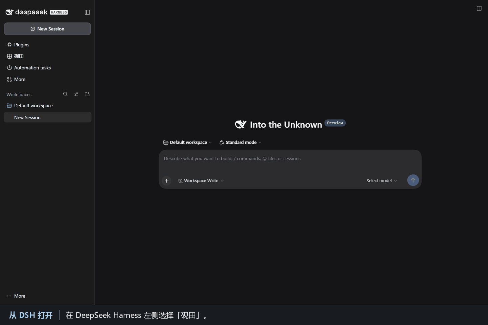
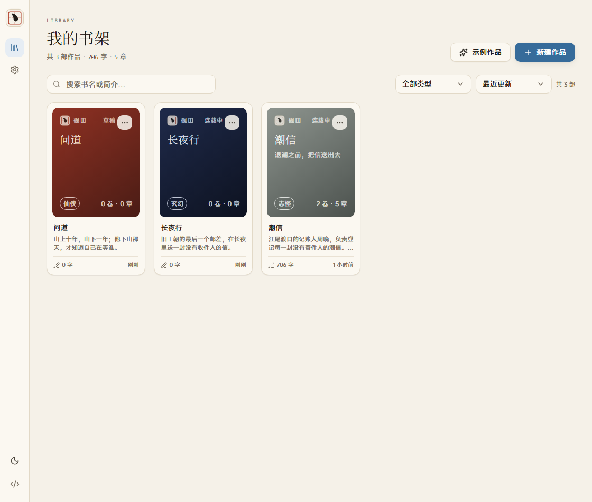
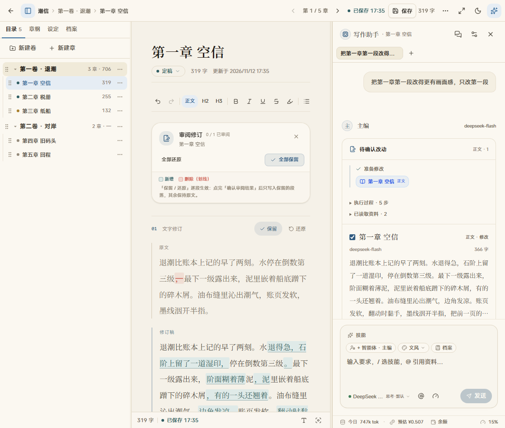
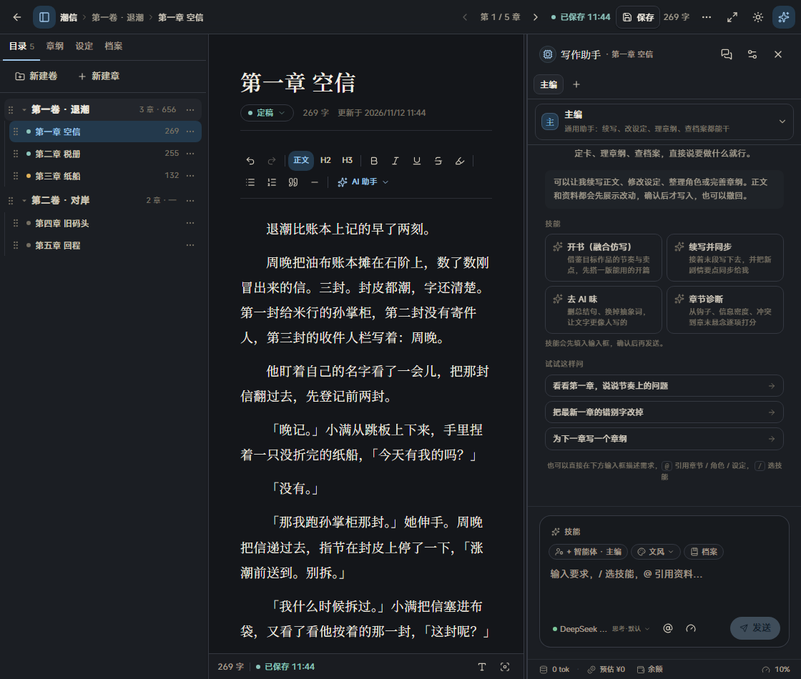

<div align="center">


# 砚田 Yanfield

**DeepSeek Harness 里的长篇写作台。**

正文、大纲、设定与 AI 助手，在同一张书桌上。<br>
书稿留在本地，模型用你已配好的 DeepSeek，AI 的改动由你逐段审阅。

[](#安装)
[](https://nodejs.org)
[](https://github.com/ZzimaR/dsh-yanfield/releases/latest)
[](LICENSE)

[安装](#安装) · [第一次使用](#第一次使用) · [功能](#功能) · [AI 与费用](#ai-与费用) · [截图](#截图) · [数据与备份](#数据与备份) · [排障](#排障) · [开发](#开发) · [English](README.en.md)

</div>

> [!NOTE]
> 砚田还在打磨中，界面与行为会继续调整。遇到问题、有想法，欢迎在 [Issues](https://github.com/ZzimaR/dsh-yanfield/issues) 里说——用「Bug 报告 / 功能建议」模板带上环境与复现步骤会快很多；也欢迎直接提 PR。

[](docs/screenshots/yanfield-in-dsh.gif)

约 24 秒。画面来自 DSH 中的隔离示例作品，审阅环节使用预置的示例改动。

<p align="center"><sub>三栏写作台 · 示例书稿 · 点击图片查看原图</sub></p>

## 这个插件做什么

砚田是一个 **DeepSeek Harness 插件**，不是独立应用：安装后 Harness 左侧导航会出现「砚田」，点开就是一个跑在面板里的长篇写作台。

界面跟随 DSH 的语言设置（设置 → 通用 → 语言）：DSH 用英文时，侧栏显示 **Yanfield**，工作台、AI 面板与设置页也全部切换为英文；中文界面保持原样。书稿内容不会被翻译，AI 用你写作的语言回复。

- **写作台**：作品 / 卷 / 章三级结构，三栏布局（目录 · 正文 · AI），自动保存、字数统计、专注模式、排版可调、宣纸 / 夜航双主题。
- **资料随写随查**：章纲、设定、角色、伏笔、故事档案都在左栏，浮窗就地编辑，不离开正文。
- **AI 改稿，作者做主**：AI 读资料、多步执行，提出正文与资料改动；正文逐段对比（绿色新增、红色删除），你决定保留哪几段，确认后才写进书稿。
- **本地优先**：书稿、设定、对话都在本机 SQLite 里；模型走 Harness 已经配好的 DeepSeek，不需要再填一遍 Key。

## 安装

需要 DeepSeek Harness `>=0.2.1-rc.5`。按你启动的 profile 选择下面一条命令，安装 [npm](https://www.npmjs.com/package/dsh-yanfield) 上的预构建包。

```bash
# Web 版
dsh plugin --profile web add dsh-yanfield

# 桌面版
dsh plugin --profile desktop add dsh-yanfield
```

安装完成后**完全退出 Harness 再重新打开**（只刷新页面不够：插件含宿主侧代码，需要重启进程）。

如果需要离线安装，可以从 [GitHub Releases](https://github.com/ZzimaR/dsh-yanfield/releases/latest) 下载 `dsh-yanfield.tgz`，再运行 `dsh plugin --profile <profile> add "<本地安装包路径>"`。

确认装好：

1. 左侧导航出现「砚田」；
2. 打开 `砚田 → 设置 → 关于`，核对版本和构建时间。构建时间是产物生成时间。

更新时用同一个 profile 执行 `dsh plugin --profile <profile> add dsh-yanfield@latest`，然后重启 Harness。回退可把 `@latest` 换成目标版本，例如 `@0.1.1`。之前用 GitHub 地址安装的用户也可以用这个命令切到 npm。

## 第一次使用

1. 点左侧「砚田」，在书架页 **新建作品**（书名、类型、封面底色、一句话简介）。
2. 进入作品后点 **写作**，就来到三栏写作台：左栏目录 / 章纲 / 设定 / 档案，中间正文，右侧 AI 助手。
3. 右侧输入框直接说需求即可，例如「把第一段改得更有画面感，只改第一段」「为下一章写一份章纲」「给周晚建一张角色卡」。
4. AI 提出的正文改动会在正文区打开审阅：逐段「保留 / 还原」，点「确认审阅结果」后只写入保留的段落；资料改动在任务卡里逐项确认。

模型来源（`设置 → 模型服务`）：

| 方式 | 需要什么 | 说明 |
| --- | --- | --- |
| DSH 账号登录 | 在 Harness 里登录 DeepSeek | 推荐，零配置；余额可直接查 |
| 官方 API Key | `DEEPSEEK_API_KEY` | 按量计费；也可在 DSH 的模型服务页填写 |
| 离线演示 | 不需要 | 只有模板文本，用于试用界面，不能真正改稿 |

两种真实路由可以在设置页一键切换，未就绪的那条会写明原因（没登录 / 没填 Key）。

## 功能



**写作**

- 作品 / 卷 / 章三级结构；新建卷、新建章、拖拽排序，章节树显示字数与状态
- 正文自动保存（延迟可调）+ 手动保存；字数、段落、阅读时间实时统计
- 排版可调：衬线 / 黑体、字号、字重、行高、字间距、段落间距、页边距、最大行宽
- 专注模式（隐藏侧栏）、打字机模式（光标居中）、写作目标与每日字数
- `Alt + 1` 收起 / 打开目录，`Alt + J` 聚焦 AI 输入框，`Ctrl / ⌘ + K` 快速跳转，`Ctrl / ⌘ + F` 页内查找

**资料**

- 总纲 / 卷纲 / 章纲三级大纲（目标、冲突、场景节拍、钩子）
- 角色卡、世界观、伏笔、故事档案（本章摘要、人物状态、设定变动、时间线、待确认冲突）
- 设定在揭示章节前默认对 AI 隐藏；关掉「AI 可见性」后即使 `@` 引用也读不到
- TXT 导入（识别「第 N 章」等标题自动拆章，预览后写入）、Markdown / TXT 导出

**AI 助手**

- 一个对话里完成续写、改稿、建卡、改设定、理章纲；带技能预设、文风选择与可自定义人设
- `@` 引用章节、角色、设定、伏笔、档案；上下文预算与分节预览可调
- 关键进展按顺序保留，当前步骤原地更新；上翻阅读时暂停自动滚动
- 正文改动在正文区逐段审阅（绿色新增 / 红色删除），资料改动按字段对比
- 写完正文自动整理「有原文依据」的资料候选，只补空白、不覆盖你写的事实
- 支持把常用指令存成提示词预设；工具栏「AI 助手」菜单收纳快捷任务



## AI 与费用

- **模型**：默认用 Harness 里已登录的 DeepSeek 账号；也可以切到官方 API Key。两条路由都在 `设置 → 模型服务` 里，显示可用状态与未就绪原因。
- **模型目录**：`deepseek-flash`（DeepSeek-V4.1-Flash，支持文本与图像）与 `deepseek-v4-pro`（DeepSeek-V4-Pro，纯文本），上下文各约 100 万 token；Harness 新增模型时会自动同步进选择器。
- **余额**：输入框底部的「余额」直接查 DSH 已登录账号的余额，不需要填 Key。
- **费用**：底部「今日 N tok · 预估 ¥X」是**今日累计**的估算，不是单次任务；单价由插件内置的 DeepSeek 官方价目表提供，按北京时间自动区分高峰与空闲（高峰为工作日 9:00–12:00、14:00–18:00，其余时段与法定节假日按空闲计，空闲价是高峰价的一半）。**估算仅供参考，账单以 DeepSeek 官方为准。**
- **省费的默认行为**：决策轮不做深度思考；小段润色、选区改写自动降档；改动很小时不触发「资料整理」；工具回执超过一定长度会截断并提示分页。一次单段润色通常几分钱，章纲任务一毛上下。

## 截图

| 书架 | 深色写作台 |
| --- | --- |
| [](docs/screenshots/library.png) | [](docs/screenshots/workspace-dark.png) |

更多：[模型服务设置](docs/screenshots/settings-models.png) · [截图说明](docs/screenshots/README.md)

## 数据与备份

- 书稿默认在 `$DSH_HOME/yanfield/yanfield.db`（含 `-wal` / `-shm` 附属文件）。`设置 → 数据` 会显示实际路径并能一键打开所在文件夹。
- 用环境变量 `YANFIELD_DB_PATH` 可指定数据库文件。若 profile 的 `cordis.patch.yml` 配置了插件的 `dataDir`，优先使用该目录里的 `yanfield.db`。
- 备份：先退出 Harness，再复制整个目录（运行中直接复制 SQLite 可能拿到不一致的快照）。
- 卸载插件不会删除书稿；数据库仍在上面那个路径里。

## 排障

<details>
<summary>左侧没有「砚田」</summary>

先确认是完全退出 Harness 后重开的（不是刷新页面），再看 `设置 → 插件` 里 `dsh-yanfield` 是否已启用、版本是否为刚装的那次。
</details>

<details>
<summary>发消息报 no API key / 模型不可用</summary>

当前路由选到了「官方 API Key」但还没有填 Key。到 `砚田 → 设置 → 模型服务` 把模型路由切回「DeepSeek 账号登录」，或在 Harness 的模型服务页填入 `DEEPSEEK_API_KEY`。
</details>

<details>
<summary>余额显示「—」或提示未登录</summary>

余额来自 DSH 已登录的 DeepSeek 账号。先在 Harness 里登录 DeepSeek 账号，再回来点一下「查询余额」。
</details>

<details>
<summary>费用一直是「费用未知」</summary>

说明这次调用没有返回 usage（比如请求中断），或者模型不在内置价目表里、你也没有在 `设置 → AI 与上下文` 里填单价。填上三档单价后会显示预估值。
</details>

<details>
<summary>书稿在哪 / 换电脑怎么迁</summary>

见上面「数据与备份」。换机器时把整个数据库目录一起拷过去即可，路径不变就不需要额外配置。
</details>

<details>
<summary>怎么卸载</summary>

```bash
dsh plugin --profile desktop remove dsh-yanfield
```

然后重启 Harness。书稿不会被删除。
</details>

## 开发

需要 Node.js ≥ 22.19（构建与自检用；运行时由 Harness 提供）。

```bash
npm ci      # 按 package-lock.json 安装构建依赖
npm test    # 构建 dist/，再运行清单检查与冒烟测试
```

```bash
client/     插件半区：Shadow DOM 挂载、插槽注册、样式入口
src/host.ts 宿主半区：/yanfield 下的 REST/SSE 路由、模型与账号桥接
vendor/yanfield/  写作台本体（React 组件、领域逻辑、SQLite 访问）
scripts/    构建、自检、冒烟、重装
docs/       功能、AI 与费用、架构、开发、常见问题
```

从本地源码安装到隔离 profile 的步骤见 [本地联调](docs/development.md#五本地联调)。架构与数据模型见 [架构说明](docs/architecture.md)，功能清单见 [功能说明](docs/features.md)，AI 接入和费用见 [AI 与费用](docs/ai-and-cost.md)，排障见 [常见问题](docs/faq.md)。

English docs: [README.en.md](README.en.md) · [docs/en/](docs/en/features.md)

## 路线图

- **v0.1.x（当前）**：三栏写作台、资料系统、AI 审阅与费用可视化；
- **下一步**：章节版本快照与回滚、EPUB 导出、更细的写作统计；
- **更远**：知识图谱视图、多模型对比、协作审阅。

## 致谢

界面与领域逻辑来自 [砚田 Yanfield](https://github.com/ZzimaR/Yanfield)。本仓库是它的 DeepSeek Harness 插件化版本：模型改走 Harness 已配置的服务，主题跟随 Harness 明暗切换，多服务商适配改为「DSH 账号 / 官方 API Key」两条路由。

## 许可

[PolyForm Noncommercial 1.0.0](LICENSE)：可以自用、学习、修改和分享，不得商用。用它写出来的小说，版权归作者。
